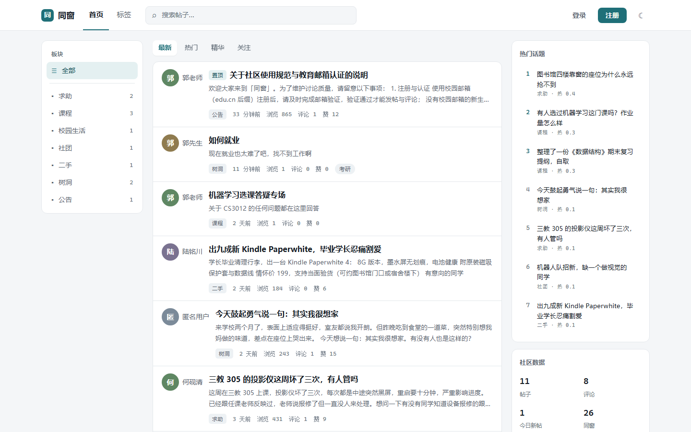
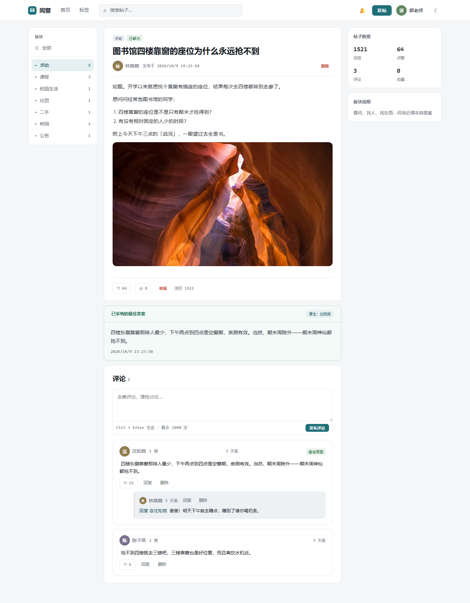
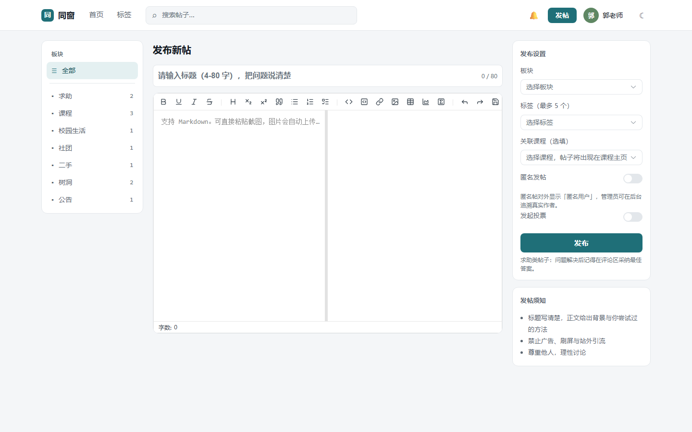
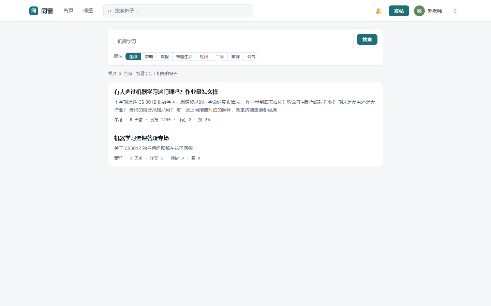
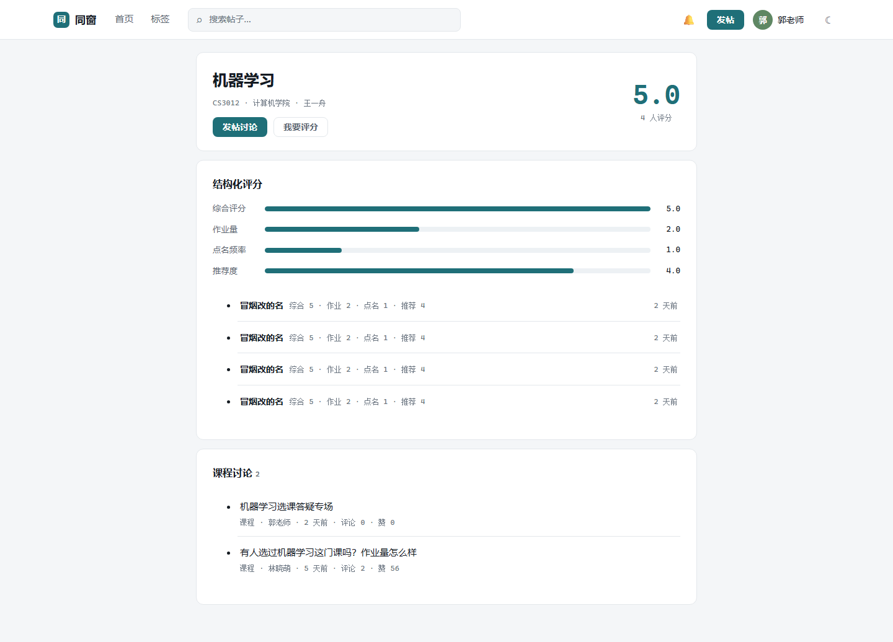
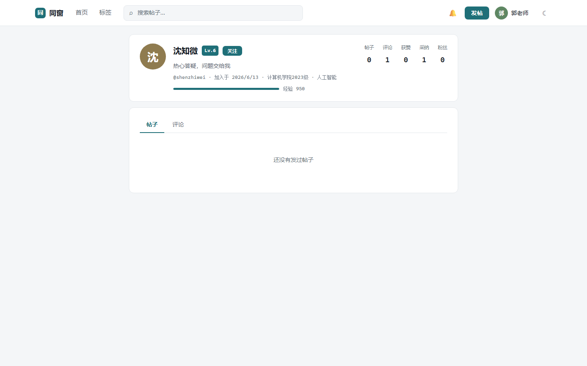
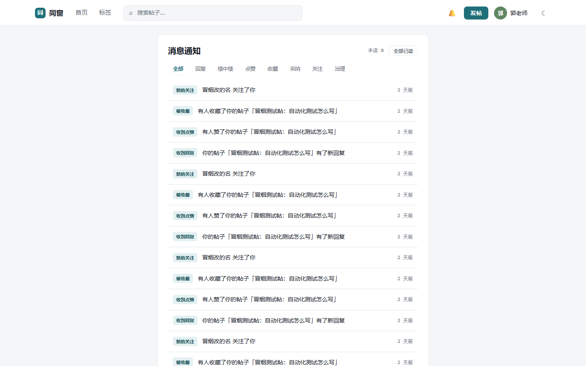
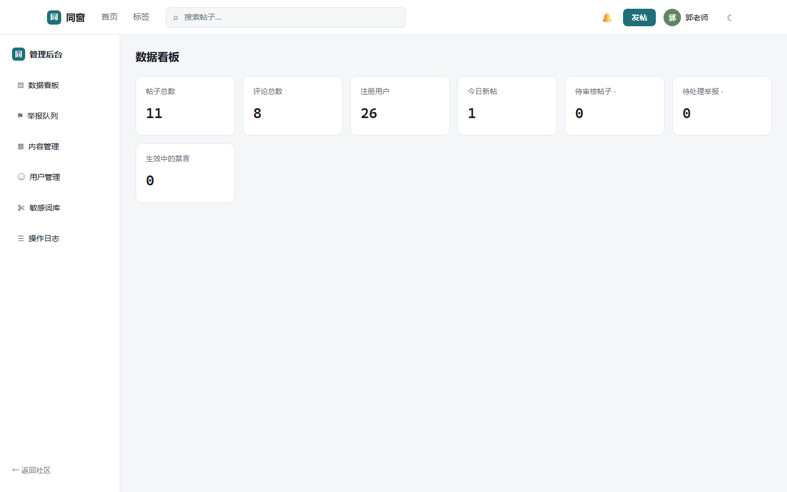
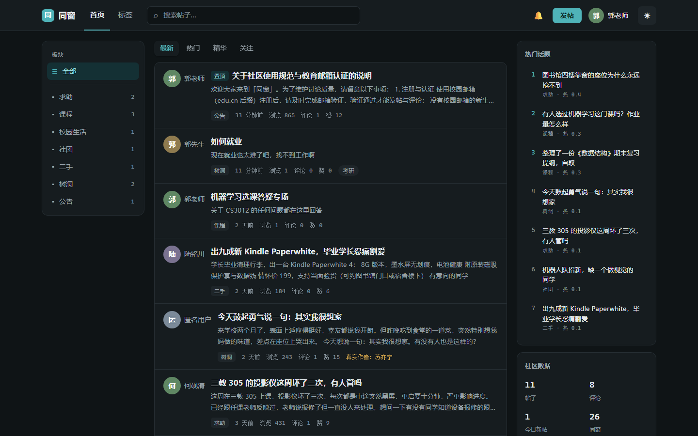

# 同窗 · 校园话题社区

> 面向校园内部的话题社区：发帖求助、交流课程、分享信息。注册受校园身份约束，内容有治理，讨论能沉淀。



**同窗**是一个完整可运行的校园论坛全栈项目：教育邮箱白名单注册、Markdown 发帖与两级评论、采纳最佳答案、ngram 中文全文搜索、热门榜、课程库与结构化评分，以及与普通论坛拉开差距的一整套校园内容治理机制（敏感词、新账号沙箱、举报闭环、管理后台）。

## 功能特性

**账号体系**
- 教育邮箱域名白名单注册（`.edu.cn` 可配置），邀请码通道覆盖无校园邮箱的新生与教职工
- QQ 邮箱验证码（含开发用 TEST_MODE，测试零发信）、邮箱验证后才可发帖评论
- JWT 双令牌（access 内存 + refresh httpOnly Cookie 轮换）、登录失败锁定、限流、忘记密码

**内容与互动**
- Markdown 编辑器（图片粘贴上传、标签、匿名开关、草稿自动保存）
- 两级评论与楼中楼（第三级自动以「回复 @某人」归一到顶级评论）、采纳最佳答案
- 点赞 / 收藏 / 关注 / 用户主页四 Tab、编辑历史（30 分钟内自由编辑，超时留档）
- 首页四种排序：最新 / 热门 / 精华 / 关注流（游标分页 + 无限滚动 + 骨架屏）

**发现**
- MySQL ngram 全文索引中文搜索（标题 + 正文，支持板块筛选与搜索历史）
- 标签广场与标签聚合页、右侧热门榜（Redis ZSET + HN 引力公式 + 定时重算）
- 课程库：课程主页聚合全部讨论、结构化评分（综合 / 作业量 / 点名频率 / 推荐度）

**治理与后台**
- 敏感词过滤（BLOCK 直接拦截 / REVIEW 转人工审核）、按角色区分的内容频率限制
- 新账号沙箱：注册 24 小时内的发帖先审后显
- 举报闭环：防重复举报、禁止举报自己、处理结果回执举报人
- 管理后台：数据看板、举报队列、内容管理（置顶/加精/锁定/下架/回收站恢复）、用户管理（禁言/封禁/角色）、敏感词库、审计日志

**体验**
- Socket.IO 实时通知与未读角标、通知中心（类型筛选、批量已读）、投票问卷
- 深色模式（设计令牌驱动，Element Plus 变量同步）、移动端适配（横滑板块、悬浮发帖按钮）

## 界面预览

| 帖子详情（采纳答案块） | 发帖编辑器 |
|---|---|
|  |  |

| 搜索 | 课程主页 |
|---|---|
|  |  |

| 用户主页 | 消息通知 |
|---|---|
|  |  |

| 管理后台 | 深色模式 |
|---|---|
|  |  |

移动端（375px）：


## 技术栈

| 层 | 选型 |
|---|---|
| 前端 | Vue 3（组合式 API + `<script setup>`）· TypeScript · Vite 6 · Element Plus（CSS 变量主题，含深色）· Pinia · Vue Router 4 · md-editor-v3 · GSAP · Socket.IO Client |
| 后端 | Express 4 · TypeScript（Node 24 原生运行，无构建步骤）· Zod · Prisma 6 · MySQL 8 · Redis · Socket.IO · Nodemailer · Multer |
| 数据库 | MySQL 8（ngram 中文全文索引、utf8mb4）· Redis（限流滑动窗口、热榜 ZSET、验证码、浏览去重） |

## 目录结构

```
Campus Forum/
├── backend/                  # Express + Prisma 后端（详见 backend/README.md）
│   ├── prisma/               #   数据模型、迁移（含 ngram 全文索引）、种子脚本
│   ├── assets/seed/          #   种子帖使用的示例图片
│   ├── uploads/              #   运行时上传落盘（gitignored）
│   └── src/
│       ├── config/           #   环境变量集中读取与校验
│       ├── constants/        #   错误码、校验正则、枚举常量
│       ├── controllers/      #   请求处理
│       ├── middlewares/      #   鉴权、限流、上传、错误处理
│       ├── routes/           #   路由表
│       ├── services/         #   业务逻辑（帖子/评论/互动/搜索/热榜/治理/后台…）
│       ├── jobs/             #   定时任务（浏览计数冲刷、热榜重算）
│       ├── sockets/          #   Socket.IO 网关
│       └── utils/            #   工具（JWT、Redis、邮件、等级等）
├── frontend/                 # Vue 3 前端（详见 frontend/README.md）
│   ├── src/styles/           #   设计令牌与 Element Plus 覆写
│   └── src/
│       ├── api/              #   接口封装（含 401 静默刷新）
│       ├── components/       #   帖子条目、评论楼中楼、投票、通知铃铛等
│       ├── composables/      #   无限滚动、GSAP 入场动效
│       ├── router/           #   路由与守卫
│       ├── stores/           #   Pinia：会话、通知
│       └── views/            #   页面（首页/详情/编辑器/搜索/课程/后台…）
└── docs/screenshots/         # README 截图
```

## 快速开始

环境要求：**Node ≥ 24**、**MySQL 8**、**Redis**。

```bash
# 1) 后端（默认端口 3100，可在 .env 修改）
cd backend
npm install
cp .env.example .env         # 填写数据库密码、JWT 密钥、SMTP 配置
mysql -uroot -p -e "CREATE DATABASE IF NOT EXISTS campus_forum CHARACTER SET utf8mb4 COLLATE utf8mb4_0900_ai_ci;"
npx prisma migrate dev       # 应用迁移（含 ngram 中文全文索引）
npm run seed                 # 种子数据：超管、板块、标签、演示用户与帖子
npm run dev                  # http://localhost:3100（WebSocket 同端口）

# 2) 前端（新终端）
cd frontend
npm install
npm run dev                  # http://localhost:5173（/api、/uploads、/socket.io 代理到 3100）
```

### 种子账号

| 角色 | 账号 | 说明 |
|---|---|---|
| 超级管理员 | `guo` / `123456` | 种子直建、邮箱已认证（**仅限开发演示，上线前必须替换**） |
| 演示用户 | 见 `backend/prisma/seed.ts`，统一密码 `demo123456` | 邮箱已认证 |
| 邀请码 | `CAMPUS2026`、`XINSHENG88` | 无校园邮箱的注册通道 |

### 邮件服务开关（防封禁）

`backend/.env` 的 `TEST_MODE` 控制验证码是否真实发送：

- `TEST_MODE=1`：验证码只写入 Redis、不实发邮件，控制台打印验证码（自动化测试与日常开发用，零邮件）
- `TEST_MODE=0`：真实发送验证码邮件（人工联调与真实使用）

改完重启后端生效。生产环境必须为 `0`。

## 数据库设计要点

- 实体关系覆盖用户 / 邀请码 / 板块 / 标签 / 帖子 / 编辑历史 / 评论（两级自关联）/ 点赞 / 收藏夹 / 关注 / 通知 / 举报 / 草稿 / 课程与课程评分 / 投票 / 审计日志 / 敏感词 / 公告
- 计数器（点赞、评论、收藏）在事务内随互动记录同步更新；浏览数经 Redis 去重后异步批量落库
- 中文搜索依赖 MySQL 8 的 **ngram 全文解析器**：schema 中声明 `@@fulltext` 索引，迁移 SQL 中补充 `WITH PARSER ngram`，服务启动时再做一次幂等兜底

## 说明

- 本项目为校园场景的完整演示实现，配套设计规范采用「公告栏」方向（冷灰白 + 深青强调色、发丝线分层、等宽元数据）。
- 超管弱密码、邮箱验证码占位等均标注为开发用配置，正式部署前请替换。
